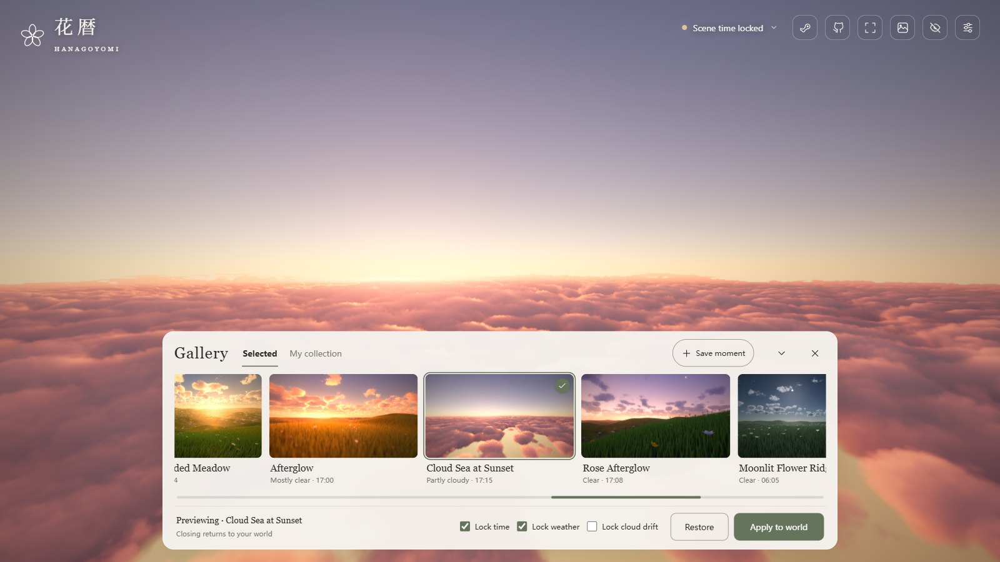
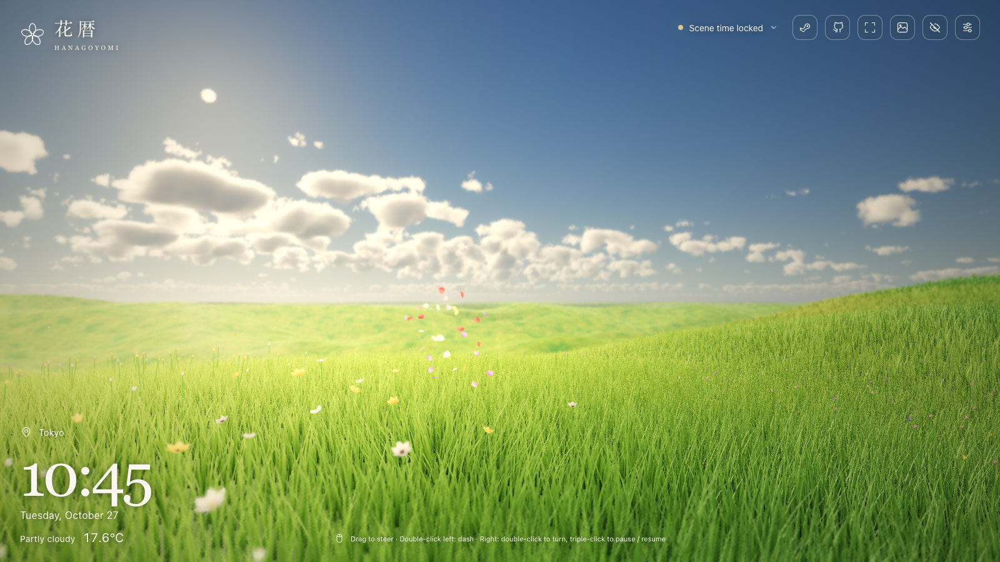
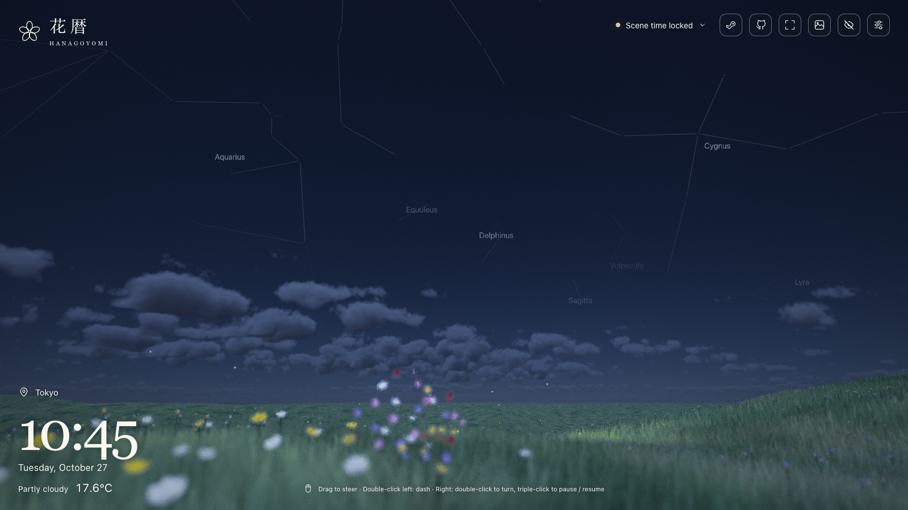

[English](README.md) · [简体中文](README.zh-CN.md)

<div align="center">


# 花暦 · Hanagoyomi

**Give this moment to nature.**

A flower meadow and sky that follow local time and weather. Roam freely, watch the stars, and save or share a view you like.

[**Try it live ↗**](https://hanagoyomi.luyilabs.com/) · [**Steam Workshop ↗**](https://steamcommunity.com/sharedfiles/filedetails/?id=3815915459)

[](LICENSE)
[](https://github.com/tadazly/hanagoyomi/actions/workflows/ci.yml)

</div>

<a href="https://hanagoyomi.luyilabs.com/#gallery=recommended-cloud-sea-dawn"></a>

<table>
  <tr>
    <td width="50%"><a href="https://hanagoyomi.luyilabs.com/#gallery=meadow"></a></td>
    <td width="50%"><a href="https://hanagoyomi.luyilabs.com/#gallery=stars&amp;lines=immersive"></a></td>
  </tr>
  <tr>
    <td width="50%"><a href="https://hanagoyomi.luyilabs.com/#gallery=recommended-southern-clouds"></a><p align="center">Realistic night sky</p></td>
    <td width="50%"><a href="https://hanagoyomi.luyilabs.com/#gallery=recommended-milky-way-fireflies"></a><p align="center">Milky Way and Fireflies</p></td>
  </tr>
</table>

<p align="center">Click a screenshot to preview its landscape.</p>

## Features

- **Daylight and weather** — Follow the selected city's local time and live weather, or choose your own time, conditions and visual effects.
- **Free exploration** — Automatic flight, mouse and keyboard or touch controls, with the option to resume from your last position.
- **Selected landscapes** — 24 scenes spanning mist, rain, snow, sunsets, moonlit nights and constellation watching.
- **Two night skies** — A brighter default style and a restrained realistic style. In the realistic sky, the Milky Way and faint stars gradually emerge while you watch from a still camera.
- **Star chart and stargazing** — View the stars even during daytime. Lock your position to highlight, find and smoothly centre constellations.
- **Constellation display** — Cloud-obscured or always-visible lines, bilingual names, and adjustable line thickness, contrast and name size.
- **Save and share** — Keep up to 100 local scenes and share them by link or QR code.

## Use

Adjust the landscape in World settings; **Sky** contains night sky and stargazing options. The interface supports Simplified Chinese, Japanese and English. Full controls are available in settings.

Choose from 50,000 cities and towns worldwide. Search by Chinese, English or Japanese names, or browse Country / region → Administrative area → City / town with an A–Z index. Wallpaper mode uses the manual list and keeps location data available offline.

Preview, restore or apply scenes from the gallery, with independent locks for scene time, weather and cloud drift. The time and weather widget continues to show the current city's live conditions. The first entry, **Where It All Begins**, restores the initial view and default scene settings while time and weather follow the current city.

Settings and collections stay on the device and do not sync between devices.

## Wallpaper Engine

Subscribe on [Steam Workshop](https://steamcommunity.com/sharedfiles/filedetails/?id=3815915459), or download a standalone wallpaper package from [Releases](https://github.com/tadazly/hanagoyomi/releases). To build your own, run `npm run build:wallpaper` and import `dist-wallpaper/index.html`. See each release's notes for included features.

Open world settings, the gallery and scene link imports from the desktop's bottom-right corner. Built-in world settings are used by default; WE native options are also available.

Use [`?wallpaper=1`](https://hanagoyomi.luyilabs.com/?wallpaper=1) for the browser wallpaper layout or Mac Plash. Enable Plash's Browsing Mode to adjust settings. See the [wallpaper guide](docs/WALLPAPER_ENGINE.md).

## Run locally

Requires Node.js 22.12+ and a browser with WebGL2 and floating-point render targets. No backend or API key is needed.

```bash
git clone https://github.com/tadazly/hanagoyomi.git
cd hanagoyomi
npm ci
npm run dev
```

Open `http://127.0.0.1:5173/`. `npm run build` creates the static site in `dist/`; `npm run preview` previews that build.

Development checks: `npm test`, `npm run build`, `npm run check:seo`, `npm run build:wallpaper`.

## Data and license

The landscape is procedural and does not recreate the selected location's terrain. Live weather uses [Open-Meteo](https://open-meteo.com/) and requires a connection; dynamic weather is used when it is unavailable. Choosing **Use my location** asks for permission to send your coordinates to Open-Meteo for the local time zone and weather. Settings and collections stay on the device.

Licensing details are provided in [LICENSE](LICENSE) and [THIRD_PARTY_NOTICES.md](THIRD_PARTY_NOTICES.md).

[Technical reference](docs/TECHNICAL.md) · [Design notes](docs/DESIGN.md) · [Contributing](CONTRIBUTING.md)
