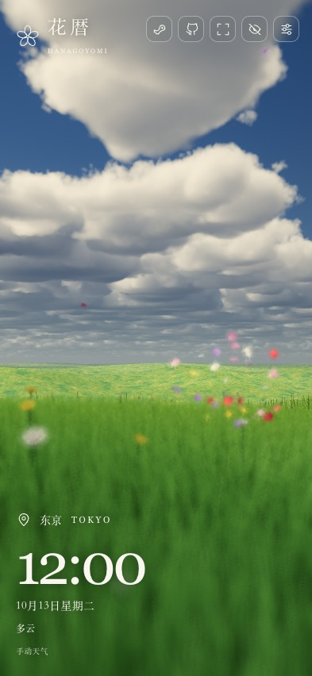

[简体中文](README.zh-CN.md) · [English](README.md)

<div align="center">


# 花暦 · Hanagoyomi

**把此刻，交给自然。**

跟随真实地点、当地时间与天气，在云、草原和花瓣之间，走进一个不断变化的自然世界。

[**在线体验 ↗**](https://hanagoyomi.luyilabs.com/) · [**在创意工坊中订阅 ↗**](https://steamcommunity.com/sharedfiles/filedetails/?id=3815915459) · [技术参考](docs/TECHNICAL.md) · [本地运行](#本地运行) · [参与贡献](CONTRIBUTING.md)

[](LICENSE)
[](https://github.com/tadazly/hanagoyomi/actions/workflows/ci.yml)


[](https://open-meteo.com/)

</div>

<a href="https://hanagoyomi.luyilabs.com/"></a>

> 截图为中文界面下的实际 WebGL2 渲染。首图展示当前版本的画廊与晚霞云海预览，下方展示白昼和夜景。草原与花海由程序生成，地形并非所选城市的地理复刻。

## 一片会变化的自然

| 世界的一部分 | 它如何变化 |
| --- | --- |
| **此时，此地** | 选择城市或使用定位，按地点的 IANA 时区显示当地时间，计算太阳、月亮、日出日落及月相。 |
| **流动的天空** | 体积云、日光散射、昼夜调色、约 5,000 颗目录恒星、星座连线与五颗行星。 |
| **天气的形状** | 显示 Open-Meteo 当前天气、温度、降水量、空气质量、云量与风速；也可漫游 16 种天气，从晴朗到雷暴、雨夹雪和暴雪。 |
| **风经过的地方** | 多级草叶 LOD、草浪、漂浮花瓣、花苞绽放、萤火虫与可选的花瓣路径记忆。 |
| **留住一处风景** | 18 幅精选风景、本机收藏和场景分享；其中四幅沿用最终 V6 宣传片的机位、景深和低饱和度设置。封面随展架浏览按需加载。 |
| **安静的界面** | 地点与时钟观测信息、四组世界设置、可调整的组件显示与位置、全屏和沉浸模式，适配桌面与触屏。 |
| **三种语言** | 简体中文、日本語、English；自动判断浏览器语言与时区，也可手动切换。 |

<table>
  <tr>
    <td width="50%"></td>
    <td width="50%"></td>
  </tr>
  <tr><td align="center">白昼 · 风与花瓣</td><td align="center">夜晚 · 星光与萤火虫</td></tr>
</table>

<details>
<summary>触屏上的花暦</summary>
<p align="center"></p>
初次访问时，移动端默认收起设置，点右上角调节按钮展开底部面板。此图为浏览器移动视口仿真。
</details>

## 本地运行

需要 **Node.js 22.12+** 和支持 **WebGL2 / 浮点渲染目标**的浏览器。无后端、无需 API Key。

```bash
git clone https://github.com/tadazly/hanagoyomi.git
cd hanagoyomi
npm ci
npm run dev
```

打开终端显示的 `http://127.0.0.1:5173/`。模块化版本需要通过 HTTP 运行。

```bash
npm test          # 时间、天文、天气与 i18n 核心测试
npm run build     # 输出静态网站到 dist/
npm run preview   # 预览生产构建，http://127.0.0.1:4173/
```

## 漫游方式

| 输入 | 操作 |
| --- | --- |
| 自动飞行时移动鼠标 | 左右转向、上下升降；移回画面中心回中，无需按住鼠标键 |
| 双击左键 | 冲刺 |
| 双击右键 | 掉头（短暂等待以区分三击） |
| 三击右键 | 暂停 / 继续飞行 |
| 暂停飞行时左键拖动画面 | 环顾四周 |
| WASD / 方向键 | 前后左右移动 |
| Q / E | 下降 / 上升 |
| Shift / 空格 | 加速 / 冲刺 |
| 滚轮 | 调整视野 |
| F / H / Esc | 全屏 / 沉浸 / 返回界面 |
| 触屏单指滑动 | 像飞行摇杆一样操控花瓣流 |
| 单指 / 两指 / 三指双击 | 冲刺 / 掉头 / 停下或继续飞行 |

设置保存在当前浏览器。拖动时刻或修改流速后进入模拟时间；点击 **跟随现在** 恢复真实当地时间。天气持续跟随当前观测数据，不会因模拟时钟改变而变成历史天气。

打开 **风景画廊**，通过鼠标拖动、触屏左右滑动或下方轨道浏览连续展架。预览会保留进入前的世界，关闭或点击“还原”即可返回，选择“应用到世界”后才保存。18 幅精选风景按光照阶段及天气关联排列，包括最终 V6 宣传片的雷雨花海、晚霞云海、薄雪花海和晴夜花海；封面接近可视区域时才加载。时刻、天气和云移动可分别锁定；时刻只固定天体与光照，天气只固定环境参数，云移动锁保留云边缘变化。草花、风、雨雪和闪电继续自然运动。时间天气组件始终显示所选观测位置的实况，调整场景需先在设置中解锁。“收藏此刻”将场景与小型 JPEG 封面保存在当前设备，最多收藏 100 个场景。

点击作品后，画廊自动收起为底部预览条，收起时仍可调整三个锁，展开时保留分类和浏览位置。切到设置不会结束当前预览。收藏副标题显示作品天气与时刻；普通浏览器可点击收藏标题修改名称，在作品菜单中分享链接或二维码。接收者打开链接即可临时预览，顶部可选择“加入收藏”或“暂不收藏”，应用到世界仍需单独确认。链接包含构图、景深、天空位置、模拟时间天气和自然运动起点，不上传封面或收藏数据；云、草花和雨雪继续运动，不保证不同显卡逐像素一致。

在 **世界设置 → 界面** 中分别控制 LOGO、时间天气和操作提示的显示。仅时间天气提供九宫格位置选择，自动避开 LOGO、操作提示和工具栏；点击“默认位置”恢复随屏幕大小调整的布局。LOGO 和操作提示保持原有自适应位置。组件设置保存在当前浏览器。

天气信息的显示项和“启动时打开世界设置”已集中到 **界面**。即使隐藏操作提示，也可以在组件设置中打开操作说明。

关闭 **常用 → 允许手动操纵** 后，鼠标、键盘、滚轮和触摸不再操纵场景，操作提示自动隐藏。自动飞行由 **常用 → 自动飞行** 独立控制：开启时继续飞行，同时关闭时镜头位置、方位和视野固定。设置面板仍可操作；重新开启交互后恢复原有提示偏好，此开关保存在当前浏览器。

在 **世界设置 → 天气 → 温度单位** 中切换摄氏度或华氏度，默认使用摄氏度，选择会保存在当前浏览器。降水量以毫米显示，并注明 API 返回的累计时段；空气质量显示 Open-Meteo / CAMS 的美国 AQI 及对应等级。空气质量请求失败不影响其他天气信息；跟随天气时缺失的指标显示“—”，动态、手动及关闭天气模式会隐藏无法获取的指标。

主界面采用紧凑布局，默认只显示天气和温度；降水量、空气质量、云量和风速默认隐藏。降水累计时段与 AQI 标准可悬停查看，也可在天气设置中阅读。在 **界面 → 时间天气显示** 中展开 **主界面天气显示**，可开关整组天气信息，或独立开关各项指标；所有开关均保存在当前浏览器。

世界设置分为常用、天气、画面、界面：常用保留地点、时间和游览方式；天气精细参数、花草与镜头细节默认折叠。画面暗角可独立开关，背景虚化设为 0% 时远近景物都保持清晰。桌面端点击工具栏的时间状态，可打开独立的时间小面板，与世界设置共用时间控件。星座连线和朝向位于 **画面 → 天空与星空**。

设置过观测地点后，**界面 → 启动与恢复** 中会出现 **启动时打开世界设置** 开关。默认关闭，后续访问时收起设置；开启后，桌面和移动端都会在启动时自动展开。

沉浸模式的 **返回界面** 按钮显示四秒后自动隐藏。鼠标靠近右下角或触摸该区域可唤出按钮；鼠标停留时保持显示，离开后四秒隐藏。也可按 **Tab** 唤出按钮，或按 **Esc** 返回界面。

## Wallpaper Engine

运行 `npm run build:wallpaper` 生成独立的 `dist-wallpaper/`，将其中的 `index.html` 导入 Wallpaper Engine。默认高画质、关闭手动交互并开启自动飞行，提供原生设置和自动隐藏工具栏。详见 [壁纸构建与验收](docs/WALLPAPER_ENGINE.md)。

浏览器可通过 [`?wallpaper=1`](https://hanagoyomi.luyilabs.com/?wallpaper=1) 预览同一壁纸体验，Mac Plash 也可直接使用此链接。Plash 中先打开 Browsing Mode 再调整世界设置；偏好保存在当前宿主，下次加载继续使用。

导入朋友分享的场景时，真实 WE 请在主窗口选中花暦，将完整链接粘贴到右侧原生“导入场景链接”（`sceneimportlink`），再返回桌面点击“预览风景”。链接只进入待导入状态，不会自动应用或加入收藏。普通浏览器和 Plash 可直接打开分享 URL，壁纸预览保留 `?wallpaper=1`；各宿主的本机世界和界面偏好仍独立保存。

## 界面语言

支持简体中文、日语和英语。首次打开按以下优先级选择语言：

1. 已在当前浏览器保存的手动选择。
2. 浏览器语言偏好列表中的第一个受支持语言（`navigator.languages`，回退到 `navigator.language`）；中文区域标签统一显示简体中文。
3. 浏览器系统时区（`Intl.DateTimeFormat().resolvedOptions().timeZone`）：日本时区使用日语，中国大陆、香港、澳门和台湾时区使用简体中文。
4. 无法获取、无法识别或不受支持时，使用英语。

在 **世界设置 → 语言** 中切换，界面立即更新，无需刷新；选择 **自动** 恢复自动判断。城市可用中、日、英名称搜索。语言判断不请求定位权限，也不发送语言或时区到外部服务。

## 从哪里开始读代码

```text
src/
├── main.js                  # 应用入口
├── data/                    # 城市、星表与星座数据
├── i18n/                    # 三语文案、语言判断与界面更新
├── world/                   # 时区时钟、太阳/月亮、天气请求与预设
├── rendering/               # WebGL2 调度、GLSL 与 CPU/GPU 共用地形
├── ui/                      # 观测界面、交互、SVG 图标
└── styles/                  # 设计令牌、布局与控件
tests/                       # 核心逻辑回归
docs/                        # 技术与设计参考
```

- [技术参考与延伸阅读](docs/TECHNICAL.md)：渲染管线、云与光、草原 LOD、天文、天气、性能边界。
- [设计说明](docs/DESIGN.md)：花暦主题、视觉令牌、响应式与可访问交互。
- [贡献指南](CONTRIBUTING.md)：开发检查和视觉验收建议。
- [第三方声明](THIRD_PARTY_NOTICES.md)：星表、天气与算法署名。

## 数据与使用边界

Open-Meteo 的当前天气来自天气模型数据，页面每 15 分钟请求一次；请求失败时明确显示 **动态天气** 并继续运行，可手动重试。云形、降水强度、积水、积雪及夜间光照采用艺术化近似，适合自然观赏，不作为气象或天文测量工具。

定位仅在点击“使用我的位置”且浏览器允许后发生，经纬度会发送给 Open-Meteo 查询天气。项目不运行用户数据库或分析追踪；浏览器设置与花瓣记忆留在本地。

移动截图和桌面运行不能保证所有手机 GPU 的性能。低性能设备可降低画质，系统会在未手动选择画质时自动降级。Safari、Firefox 和实体手机的兼容性仍需要持续验证。

## 致谢与许可

灵感来自 thatgamecompany 的《Flower》；本项目与该游戏及其团队无关联。算法阅读入口见[技术参考](docs/TECHNICAL.md#延伸阅读)，星表来自 [d3-celestial](https://github.com/ofrohn/d3-celestial)，天气由 [Open-Meteo](https://open-meteo.com/) 提供。

项目代码使用 [MIT License](LICENSE)。第三方数据及服务遵循各自许可；MIT 授权不改变 Open-Meteo 免费接口的非商业使用条件或天气数据的署名要求，详见[第三方声明](THIRD_PARTY_NOTICES.md)。
