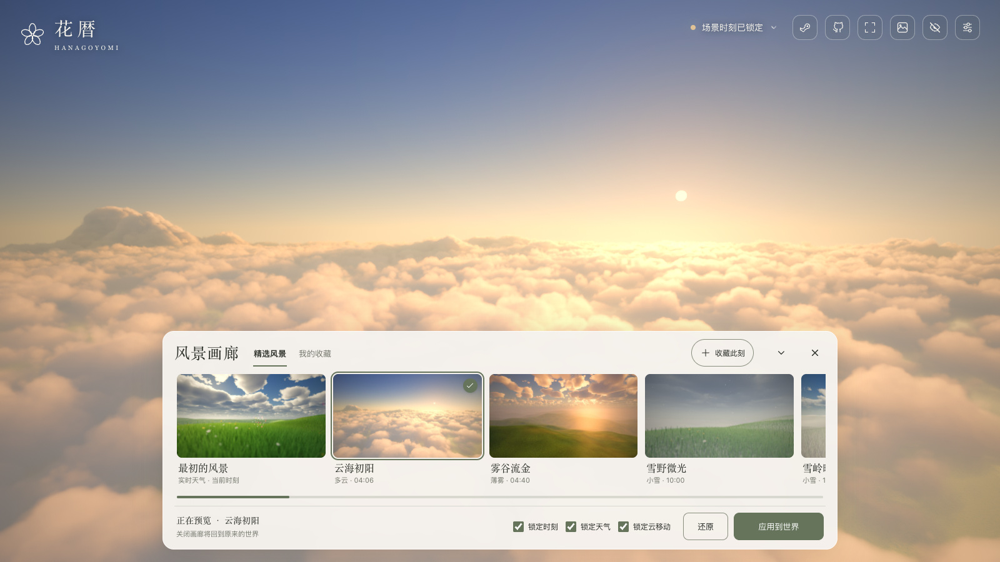
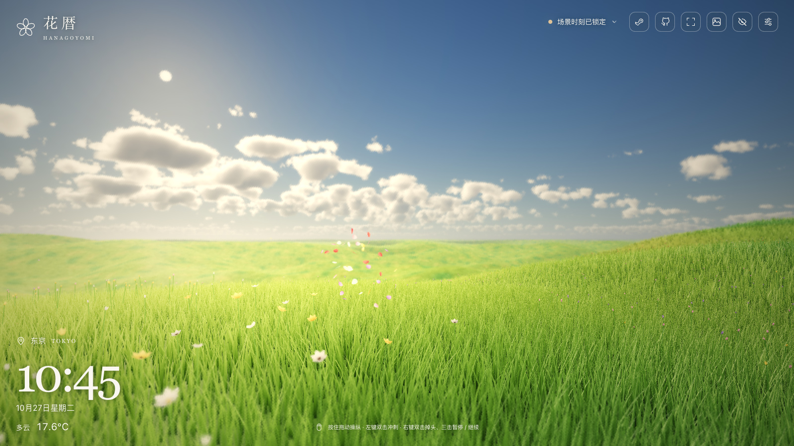
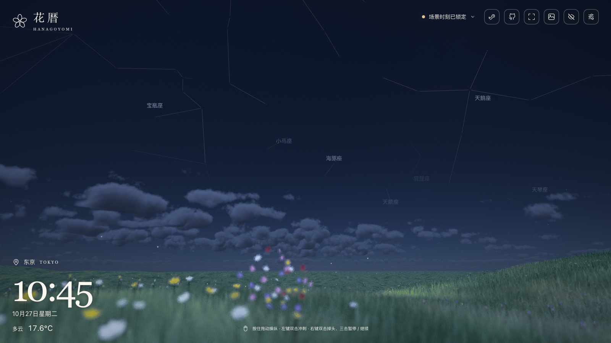
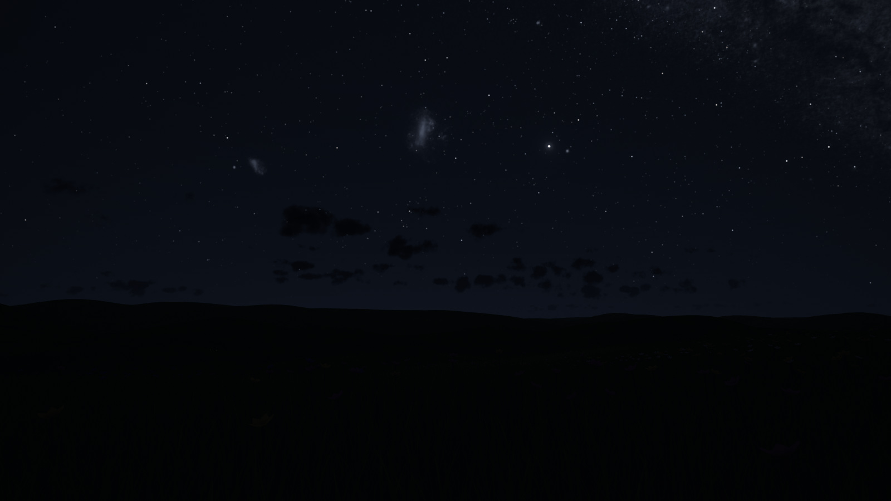
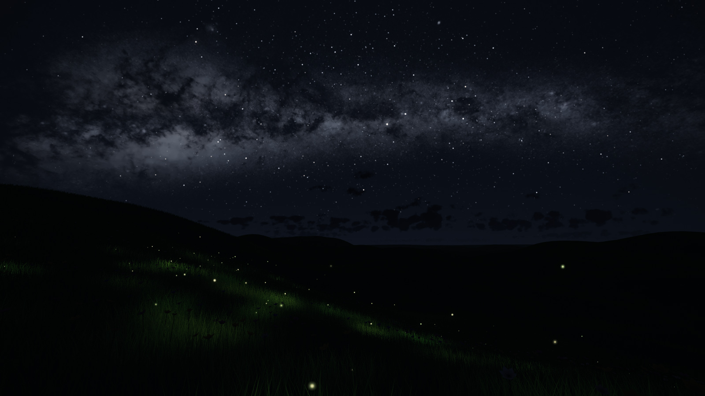

[简体中文](README.zh-CN.md) · [English](README.md)

<div align="center">


# 花暦 · Hanagoyomi

**把此刻，交给自然。**

一个随当地时间和天气变化的花海与天空。自由漫游、仰望星空，也可以保存和分享喜欢的风景。

[**在线体验 ↗**](https://hanagoyomi.luyilabs.com/) · [**Steam 创意工坊 ↗**](https://steamcommunity.com/sharedfiles/filedetails/?id=3815915459)

[](LICENSE)
[](https://github.com/tadazly/hanagoyomi/actions/workflows/ci.yml)

</div>

<a href="https://hanagoyomi.luyilabs.com/"></a>

<table>
  <tr>
    <td width="50%"></td>
    <td width="50%"></td>
  </tr>
  <tr>
    <td width="50%"><p align="center">写实夜空</p></td>
    <td width="50%"><p align="center">横河萤野</p></td>
  </tr>
</table>

## 功能

- **昼夜与天气**：跟随所选城市的当地时间与实时天气，也可自由调整时刻、天气和画面效果。
- **自由漫游**：支持自动飞行、鼠标键盘与触屏操纵，可记住上次停留的位置。
- **推荐风景**：24 幅精选作品，涵盖晨雾、雨雪、晚霞、月夜与星座观赏。
- **两种夜空**：默认风格明快，写实风格更克制；静止观赏写实夜空时，银河与弱星逐渐显现。
- **星图与观星**：白天也可查看星空；观星模式固定位置，支持星座高亮、查找与平滑定位。
- **星座显示**：提供随云遮挡或始终显示的连线、双语名称，以及粗细、清晰度和字号调节。
- **收藏与分享**：最多保存 100 个本机收藏，通过链接或二维码分享风景。

## 使用

在世界设置中调整风景，“天空”页提供夜空和观星选项。界面支持简体中文、日语和英语，完整操作说明可在设置中查看。

画廊支持预览、还原和应用，场景时刻、天气与云移动可分别锁定；时间天气组件仍显示当前城市实况。首项“最初的风景”可恢复初始构图与默认场景设置，时刻和天气继续跟随当前城市。

设置与收藏保存在本机，不会跨设备同步。

## Wallpaper Engine

可从 [Steam 创意工坊](https://steamcommunity.com/sharedfiles/filedetails/?id=3815915459)订阅，或从 [Releases](https://github.com/tadazly/hanagoyomi/releases) 下载独立壁纸包。自行构建使用 `npm run build:wallpaper`，将 `dist-wallpaper/index.html` 导入 Wallpaper Engine；安装包功能以对应版本说明为准。

支持壁纸内世界设置、画廊与场景链接导入，在桌面右下角打开。默认使用壁纸内设置，也可切换为 WE 原生选项。

浏览器壁纸布局和 Mac Plash 使用 [`?wallpaper=1`](https://hanagoyomi.luyilabs.com/?wallpaper=1)。Plash 中需开启 Browsing Mode 才能操作设置。详见[壁纸说明](docs/WALLPAPER_ENGINE.md)。

## 本地运行

需要 Node.js 22.12+，以及支持 WebGL2 和浮点渲染目标的浏览器。无需后端或 API Key。

```bash
git clone https://github.com/tadazly/hanagoyomi.git
cd hanagoyomi
npm ci
npm run dev
```

打开 `http://127.0.0.1:5173/`。`npm run build` 输出静态网站到 `dist/`，`npm run preview` 预览构建结果。

开发检查：`npm test`、`npm run build`、`npm run check:seo`、`npm run build:wallpaper`。

## 数据与许可

场景由程序生成，不复刻所选地点的地形。实时天气由 [Open-Meteo](https://open-meteo.com/) 提供，需要联网；无法获取时回退动态天气。点击“使用我的位置”并授权后，经纬度会用于查询天气。设置与收藏保存在本机。

许可和第三方来源见 [LICENSE](LICENSE) 与 [THIRD_PARTY_NOTICES.md](THIRD_PARTY_NOTICES.md)。

[技术参考](docs/TECHNICAL.md) · [设计说明](docs/DESIGN.md) · [贡献指南](CONTRIBUTING.md)
