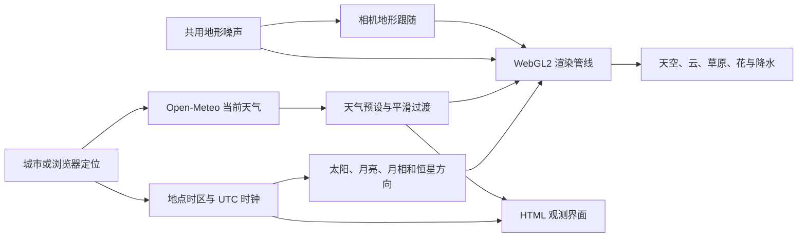

# 花暦技术参考

这份文档按当前源码整理自然世界的实现方式，便于学习、复用和继续改进。项目使用原生 JavaScript ES Modules 与 WebGL2，Vite 负责开发服务和静态构建，不依赖通用三维引擎。

## 模块与数据流



| 文件 | 阅读重点 |
| --- | --- |
| [`world/clock.js`](../src/world/clock.js) | UTC 与地点时区转换，真实时间与模拟时间的边界 |
| [`world/astronomy.js`](../src/world/astronomy.js) | 低精度天体位置、月相与日出日落 |
| [`world/weather.js`](../src/world/weather.js) | 天气 API、字段验证、WMO 代码 |
| [`world/weather-presets.js`](../src/world/weather-presets.js) | 16 种天气参数及动态天气转移权重 |
| [`rendering/terrain.js`](../src/rendering/terrain.js) | CPU 与 GPU 共用的地形噪声 |
| [`rendering/shaders.js`](../src/rendering/shaders.js) | GLSL 的云、天空、草、花、降水与后处理 |
| [`rendering/world.js`](../src/rendering/world.js) | 图形资源、模拟状态、输入与逐帧调度 |
| [`ui/shell.js`](../src/ui/shell.js) | 界面状态、观测信息、全屏与沉浸模式 |
| [`world/scene-state.js`](../src/world/scene-state.js) | 场景协议校验、当地时刻转换与独立时钟 |
| [`data/gallery-scenes.js`](../src/data/gallery-scenes.js) | 精选风景的构图、环境参数与三语文案 |
| [`ui/gallery.js`](../src/ui/gallery.js) | 风景预览、收藏和应用到世界 |
| [`world/gallery-store.js`](../src/world/gallery-store.js) | 有容量限制的本地收藏与封面保存 |

`world.js` 保留完整渲染调度以减少原始效果迁移风险，后续可逐步分离 GL 资源管理、相机和天气模拟。CPU/GPU 同名参数应保持一致。

## 1. 时间与天文

### 同一时刻，不同地点

内部使用 UTC 毫秒。城市包含经纬度与 IANA 时区，使用 `Intl.DateTimeFormat` 计算地点偏移，不根据经度简单猜测时区。时区偏移按分钟缓存，夏令时仍按对应日期转换。

真实模式每帧读取 `Date.now()`，避免标签页进入后台后因为动画帧被限速而落后。模拟模式根据单调时钟的完整帧间隔推进，移动和物理效果单独限制 `dt`，避免恢复页面时相机突然飞出。

```js
simMs = followNow && speed === 1
  ? Date.now()
  : simMs + elapsedMs * speed;
```

调整当地时刻时，用目标时刻的时区偏移转换回 UTC。夏令时跳过的时刻会归一化到相邻有效时刻；重复时刻没有提供两次时刻的独立选择。测试包含夏令时变化日和半小时偏移地区。

### 天体方向与日出日落

太阳和月亮采用低精度黄道坐标近似，经赤道坐标与地方恒星时转换为地平高度和方位。太阳方向决定云、草与地面的主要光照；月相来自日月黄经差。夜晚的月光和环境光经过艺术化增强，让暗处仍可观赏。

日出日落以太阳高度 `-0.833°` 为阈值，在当地一天内按约 10 分钟采样并插值求交点；同时识别极昼、极夜。当地日的长度允许 23 或 25 小时。它不是高精度星历，也未加入建筑遮挡、真实山地地平线和精密大气折射修正。

5,044 颗恒星及 1,486 个星座线顶点以紧凑 Base64 二进制保存，解析为位置、星等与色指数。星空随地方恒星时旋转，云透射率用于遮挡星光。行星使用 JPL 的近似轨道元素，源代码参数对应 1800–2050 年范围；不宜用于精密观测。[JPL 原始资料](https://ssd.jpl.nasa.gov/planets/approx_pos.html)

两种风格的恒星共用 B−V 色指数→Ballesteros 估温→黑体 RGB 经验拟合，并向白色混合 35%；这是数据驱动的显示近似，不是逐星实测 RGB。默认星表保留原有量化 B−V；写实星表使用 Hipparcos 原色指数，缺测回退中性白。星座线端点复用对应风格恒星的源颜色，写实表按角距 ≤0.01° 交叉匹配（757 个唯一端点中 756 个匹配，缺测保持白色），在线性能量中渐变。原始星等只映射到 0.6–1 的有界透明度系数，叠加既有线亮度；不依赖天气可见度或写实静止曝光积累。云遮挡继续逐片元计算，选中柔光保留星色。[Hipparcos 数据字段](https://heasarc.gsfc.nasa.gov/W3Browse/all/hipparcos.html) · [Ballesteros 2012](https://arxiv.org/abs/1201.1809)

天空设置独立提供观星模式。观星时固定世界位置、高度和相机位置，暂停自动飞行；拖动只改变朝向，选择星座沿最短方位平滑居中，手动拖动可取消跟随。退出后不会自行恢复飞行。88 个现代星座的分组、简体中文、日语及英语名称来自同源 d3-celestial 数据，巨蛇座两部分共用选择状态，原有 743 段几何保持不变。日语名称保留末尾「座」，与 [NAOJ 名称表](https://eco.mtk.nao.ac.jp/koyomi/faq/constellations.html)及 [StellaNavigator 官方参考手册](https://www.astroarts.co.jp/products/stlnav12/support/manual/Stlnav12stk.pdf#page=8)中的「オリオン座」等用法一致；不采用 Stellarium 的省略式标注。定位列表选择后自动进入观星并平滑定位；不再设置额外居中或取消选择按钮。鼠标拾取半径 20 CSS px，触摸 28 CSS px，包含星点端帽，继续按指针位置的云透射率与地形遮挡判定。

连线和名称在最终 SDR 映射后合成，使用 CSS 像素线宽、抗锯齿三角形、端点留白、标签避让与平滑高亮；选中后增加有限的局部柔光。标注不参与写实静止曝光积累。沉浸模式逐像素依据当地云透射率、恒星可见阈值、地形深度与月盘遮挡淡出，共用恒星的光度和消光函数；端点星等仅作为光度参考，不把端点被云遮挡扩大为整段隐藏。始终显示允许透云识图，仍保留地形和月盘遮挡。日月遮挡同时复用 FINAL 的雨滴折射与 5 点模糊覆盖，避免连线伸入被雨滴偏移的日月盘；标注几何保持屏幕空间。拾取复用相同 GPU 可见性，使用 1 像素 PBO 异步读取；名称字图采用约 2 MiB 的 R8 纹理，仅在语言或双语选项改变时上传。

天空显示提供「自然 / 星图」两种选项；内部沿用 `atmosphere` 布尔偏好兼容旧存档（true 为自然、false 为星图），不改作品分享协议。星图的环境采用无月夜照明：天空、云层、地景、曝光和调色统一渐变至无月夜，关闭太阳与月亮直射、人工夜间补光及多重散射近似，但保留空气辉光与场景自发光。不改变天文时刻、恒星与行星方位；天气、地形和云层遮挡仍然保留。太阳与月亮仍按当前天文时刻的真实方向绘制，月相与月面朝向不变；仅光盘可见，不恢复环境直射。默认风格在自然与星图之间共享程序月面的海纹、月相柔边和朝向，写实风格保留真实月面贴图；默认自然月盘的亮度上限随自然显示权重同步淡出，避免饱和月盘在过渡末尾骤灭，也不依赖异步月面贴图就绪。默认星图月盘以旧版过渡末端的明亮月盘为参考，线性峰值为 4，保留自然月光的色比并移除预曝光强度；局部 Gaussian 柔光随月相和月出淡化，总支持域为月盘半径的 3.5 倍，真实遮星盘仍保持原半径。日月在泛光提取后、FINAL 前通过局部 scissor 合成有界后曝光能量，不乘场景曝光、不参与曝光积累或全局泛光；HDR 使用线性加法，切换途中的 SDR 使用 screen 合成。光盘与背景共用最终雨滴折射和镜头合成，避免雨滴下的光盘与遮星孔错位。太阳输入色在默认、写实及低饱和方案中分别校准，抵消默认冷色夜景调色造成的蓝灰色辨识混淆，色调各通道上限为 1；星图太阳与自然太阳共用交接进度：旧光盘在人工 HDR 开始前平滑收敛高光，新光盘的色调、柔光和有界增益同步从 1 升至 12，避免虚拟太阳跨越暮光区间过快造成增亮跳变。SDR 在应用云透射率、遮挡和显示权重后完成 ACES 与 sRGB 编码，保持 screen 输入不超过 1，确保太阳光盘在显示上比行星亮点更醒目。最多两次小范围绘制，仅增加复用 sceneTex 的纯色附件 FBO，无新增全屏纹理缓冲。从自然 SDR 进入星图的人工暮光中，泛光 RGB 储存线性能量、原有空闲 alpha 储存独立提取的显示域亮度；两者经同一滤波链后，在最终显示域对结果插值，避免线性强光直接加到 SDR 造成闪白。显示域泛光在此短暂过渡中采用无彩色亮度近似；自然暮光保留原流程，无新增泛光纹理或绘制。复用云透射率、天气雾与地形深度，月亮暗面和太阳光盘同步遮挡后方星点、银河及标注，日月重叠时月亮在前。天空景深同时退回清晰点源，避免近处花瓣对焦把白天恒星摊成淡斑。星图显示时将云射线的最远起点从 95 km 按相机高度与球面切线距离连续延长，并在末段平滑淡出，避免地平线露出裁剪条带；单条射线的步数与积分云段上限不变。地形遮挡按深度清值 1 判定。选择自然后恢复原有昼夜效果。萤火虫在 HDR 缓冲中使用线性加法，避免 Screen 混合的负目标系数扣暗高亮星点；保留对地形花草的深度测试，不让透明发光光斑写入不透明深度。HDR 光斑沿用背景景深与原有径向柔边，SDR 保留原混合及景深路径。星图中的金星按 Mallama & Hilton (2018) §3.2 的两段实测相位公式渐变校正光度，避免旧距离公式在近合日时估到约 −8 等而产生过大 HDR 光团；相位超过 179° 时使用文献适用边界近似，真实轨道与距离不变。自然模式保留原行星显示值。星图点源在云透射与日月遮挡之前仅压缩超过 1.6 的线性亮核能量，默认与写实分别渐近限于 5 和 3.8，减少进入全局 Bloom 的过量能量；弱星、星等数据和 RGB 比例保持不变，自然模式保留原输出。星图太阳另加宽度不超过 8 CSS px（默认）或 6 CSS px（写实）、且不超过日盘半径 1.5 倍 的局部 Gaussian 柔光，从太阳中心连续衰减，不在盘外单独形成光环；光盘与柔光共同限幅，不参与全局 Bloom；强度独立限幅，按可见日面面积抑制，满食时归零。[光度公式来源](https://arxiv.org/abs/1808.01973)除原有作品中的 `constel` 布尔开关外，观星交互和显示调整均属于本机偏好，不改变旧作品及分享链接协议。

## 2. 体积云与大气

### 云的密度

启动时生成 `128³` 形状噪声、`64³` 细节噪声和 `512²` 天气纹理。Perlin 与 Worley 噪声提供团块和侵蚀细节，再结合云层高度、云量和密度塑形。生成任务分帧执行，界面显示进度。

视线与球形云层相交后沿射线步进。每步根据密度估算消光、光照透射与散射；透射率足够低时提前结束。Beer–Lambert 形式可概括为：

```text
T_segment = exp(-extinction * density * distance)
L_accum  += T_accum * L_scatter * (1 - T_segment)
T_accum  *= T_segment
```

云使用前向与后向 Henyey–Greenstein 相函数混合、多级散射近似，以及顶部天空光、底部地面反照与云内遮蔽。它是实时观赏方案，不是完整的多次散射物理求解。[Frostbite 课程入口](https://sebh.github.io/publications/)、[Guerrilla 体积云分享](https://www.guerrilla-games.com/read/the-real-time-volumetric-cloudscapes-of-horizon-zero-dawn)

### 体积云风格

天空设置在夜空风格上方提供「默认 / 写实」。默认沿用原渲染；写实由 `55f914e` 的 EVE 云适配而来，沿用六类云型的 Hermite 高度与密度曲线、128³ R8 侵蚀噪声、三角网格去平铺、自适应步进、光程积分、多重散射、体积光照与云前空气。写实云独立塑形，云层为源 1750–7450 m，默认仍为 1500–4000 m。源天气场与侵蚀场使用独立 600 km 虚拟球面，当地水平距离通过指数映射衔接；宿主云壳相交仍使用 6371 km。镜头上限、推荐机位、地形、太阳盘和全局调色不随风格改变。

三档源天气图保持原始 R 覆盖度与 G 云型数据。以原始高档图为共同基准，在源 600 km 地图上用约 12 km 标准差的分离核估计局部均值与方差，加入经度周期、跨极反射与纬度面积权重；这是球面平滑近似。固定统计图为 1024×512 RG8、无 mip，约占 1 MiB GPU 内存；R 编码均值，G 将标准差下限 0.06 至上限 0.5 映射至 0–1。统计图只在首次选择写实时请求一次，跨画质复用，和天气图使用同一球面 UV、风相位与线性采样，不按镜头重新统计。`node scripts/prepare-cloud-weather-stats.mjs [输出目录]` 从固定原始 Git 版本重建统计图，离线工具需要 Python 3 / Pillow，普通构建不需要。元数据记录源资源与编码器版本、压缩哈希和解码像素哈希，跨编码器以像素哈希判断等价。

云量滑块范围为 0–100%。低云量使用标准化天气值 `clamp(0.5 + 0.125 * (R - 均值) / 标准差, 0, 1)`，通过两条单调 Hermite 阈值曲线按原始 G 在层云与积云轮廓间连续混合。软阈值与随云量增加的云核峰值保留侵蚀细节；潜在覆盖上界来自原始源高覆盖场，不能凭归一化抬高原场的最大密度。输入 0.55–0.88 连续回归源覆盖场。另以原映射节点的单调 Hermite 参考场与校准结果做凸混合，权重为固定局部均值的 `smoothstep(0.15, 0.30, 均值)`：稀疏源场保留原响应，密集源场充分校准，避免原本接近默认的晴朗、少云场景反而偏离。权重不随云量、机位或时间改变，因此组合仍单调。这个保护会回撤部分稀疏云场的增云收益，不能同时保证每个机位都对齐默认。

输入 0.88–0.97 保留原始覆盖与侵蚀公式，并跳过统计纹理采样；厚云和云海保留原来的云块、云孔与光照层次。末端另连续淡出或填满，使写实 0% 明确无云、100% 完整覆盖潜在云场。0% 的云 pass 直接输出透明，也跳过密度中的天气采样。各分量与最终组合均单调、有界。

视线、阴影、太阳与环境光程缓存共用同一密度入口；低于 0.88 的每次密度查询增加一次统计图采样，高云量不增加该采样。加载成功统一重置光照与 TAA，切档晚到、失败和取消路径释放临时图片与纹理，天气图仍只保留当前一张。没有按场景 ID、镜头位置或时刻特判，也没有修改全局天空、雾颜色或源密度系数。云量参数是体积场控制量，不等于画面有云像素百分比；两套风格的云层高度、云型与相机位置关系不同，不能承诺同数值下轮廓或遮挡完全一致。默认的 0% 仍保留原天气场行为。

低云量中局部校准权重为零时直接使用参考值，跳过归一化与软阈值的无效计算，密度场保持不变。曾尝试额外编译高云量专用程序，但同云场 ABBA 测试未显示稳定收益，故不保留额外程序与启动编译成本；昼夜和天气仍共用现有的一套写实程序。
写实噪声在网页首次选择时按需加载，默认不会请求该数据 chunk；壁纸构建内嵌数据以兼容 `file://`。三档天气图保留源无损 WebP，按当前画质及设备 MAX_TEXTURE_SIZE 选择，GPU 只保留一张 RG8、仅 mip0（低/高/极高分别 4/16/64 MiB）；画质切档时在新纹理上传成功后删除旧纹理，取消旧请求并防止晚到覆盖；上述为稳态GPU纹理内存，切档短暂包含新旧两张纹理及解码图片。相较源三档 RGBA8+mip 全常驻约 224 MiB，消除了无收益的多档驻留与 mip。上传关闭颜色空间转换，保留覆盖度和云型数据值；失败请求采用有上限的退避。写实程序与 LUT 在昼夜 HDR 间共享，只创建一套；光照体积在画质变化时释放旧纹理及临时 FBO。首次或密度场重置只清缓存，太阳光与半球环境遮蔽按有限切片逐帧回填，避免一帧执行整卷积分；未回填或 cubic 足迹越出缓存圆盘的区域使用有界光程近似，不能把清零的 OD 当成完全透光。暮光和夜间环境照明保留宿主天空贡献，避免主光切到月亮时云层变成黑色剪影。

写实云太阳光的近程积分固定覆盖最多 1.2 km，只抖动分段内的采样位置，远程缓存从同一终点接续，消除原来一整步未积分的漏光间隙。体积积分使用较密的近端分段与中点采样，包含不足一步的短段和最后一段，最大采样预算不变；缓存外的 12 步太阳积分仍是实时近似，低太阳高度的远处小云团可能欠采样。环境光使用稳定的六方向分层半球采样，历史按视觉时钟的切片年龄指数收敛（稳态响应时间 0.25 s、天气渐变 0.08 s），不再长期混入旧天气。天气渐变暂时加倍每帧更新切片，移动重投影保留历史年龄。TAA 按主光方向与 RGB 的实际变化连续调整混合权重，避免天气缓存刷新标记在 0.1 / 0.35 两个权重间跳换；转向、闪电及高倍速的响应保留。

厚云多重散射使用 `0.5 exp(-0.25 OD) + 0.5 exp(-0.45 OD)` 的指数透射拟合：OD 1–2 与原响应接近，OD 10 / 20 的贡献降至原来的约 51% / 12%，削弱深层过亮长尾，保留朝阳云顶、薄云银边及夜间环境光。设计参考 [Frostbite §5.8 的多阶指数散射](https://media.contentapi.ea.com/content/dam/eacom/frostbite/files/s2016-pbs-frostbite-sky-clouds-new.pdf) 与 [Unreal 的散射和遮蔽说明](https://dev.epicgames.com/documentation/en-us/unreal-engine/volumetric-cloud-component-in-unreal-engine)，属于工程拟合，未实现完整多阶输运或宣称严格能量守恒；该光照修正不额外调整相函数与环境光增益；覆盖度适配见上文。

写实云的最远起始距离按相机与云底的球面切线距离之和计算，额外保留 2% 几何余量，自然天空与星图共用这一范围，避免固定 95 km 截断形成水平云底。每条射线仍最多积分 60 km 云段、沿用原自适应步进和最大步数。在合成前按代表云深度，将 95 km 至可见距离 85% 的极远云连续淡入空气背景；预乘散射与不透明度同步淡出，避免按射线入层距离形成齐平的红色或黑色细条。这一距离消隐不作用于 95 km 内的云和云海主体，也未改变云密度场；云前空气颜色另按下述方式调整。默认风格保留原来的范围与大气切换行为。

云前空气使用与天空相同的实际太阳、月亮和预曝光端点能量；云体选用的艺术主光与云亮度增益只服务云内照明。空气积分共用原有视线光学厚度与步数，有月光时每步补一次透射 LUT 读取；宿主近地颜色校准、多重散射和空气辉光也沿光学路径加入，后两者以 `1 - viewT` 近似有限路径贡献。这样避免暮光切换主光后遗漏太阳与蓝色多重散射，在远云下缘留下褐黑色带；这是与宿主天空衔接的工程近似，不是完整多阶散射求解。

性能信息中的「显示在主界面」默认关闭，属于本机渲染偏好，不进入作品或分享链接。开启后左上角显示 FPS、帧时间、云缓冲、草叶数及 GPU，复用原有半秒统计；根据 LOGO 实际位置避让，响应组件移动、隐藏和窗口大小变化。

云风格进入作品、收藏和 v5 分享链接；默认云继续生成原 v3/v4 链接，v1–v4 旧作品缺字段时使用默认云。预览取消恢复原世界的云风格。

### 低分辨率与历史累积

云缓冲以 CSS 视口为基准，比例随画质变化，并设置约 115 万像素的上限。写实高档比例采用 0.65，以控制高空密云场景的像素成本；保留原自适应步进、光照预算和全分辨率 LOD 足迹，不调整云型曲线、云层高度或密度参数。画质选择及设备性能仍会影响实际帧率。云颜色保存在浮点纹理中，同时输出云深度。TAA 根据云深度、相机位移和上一帧视锥重投影历史；用 3×3 邻域均值、方差和范围限制历史值，以减轻拖影。转向、光照变化和闪电时提高当前帧权重，尺寸变化时重置历史。

天气雾与云按深度分层合成：天空、地形各自保留背景路径上的雾，云的前景雾只积分到已有云深度。两侧使用相同的预乘散射与透射公式，避免高空大雾在地形远端出现云内接缝，也保留近地雾对远云的遮蔽。不增加云步进数或模糊通道。

贴地背景天空对穿过参考地面的视线补齐雾柱，避免真实地形遮挡前露出一行明亮晚霞；默认云与写实云共用此路径。补偿按实际离地高度计算，5 m 以下完全启用，5–15 m 平滑退出，15 m 以上沿用原积分；不按立即切换的目标天气类型开关，避免大雨漏补偿或天气渐变途中提前撤回。参考地面以下的背景雾密度封顶为地面密度，雾柱由两侧高斯尾与中间常密度段构成，在贴地几何地平线两侧连续衔接，也避免地下指数放大。晴空消光为零时跳过雾，高空浓雾与云层合成保留原路径。

大气部分计算 Rayleigh、Mie 与臭氧消光，使用小型天空 LUT 避免每个场景像素都执行完整积分；另外近似多重散射，让日落后高空仍保留颜色。

## 3. 草原、风与花瓣

### 同一片地形

地形由五组尺度、方向和振幅不同的噪声叠加。CPU 高度采样和 GLSL 使用相同纹理及参数。CPU 负责相机高度、前方坡地预采样和花瓣路径；GPU 将地形、草和花放到同一地表。修改其中一侧而未同步另一侧，会造成穿地或悬浮。

近景草使用实例化几何草叶，多级网格按距离改变密度与草叶段数；中景草层与远景地形保持一致的颜色和光照。网格在相机附近循环复用，并按视锥裁剪。风由大尺度风浪、局部噪声和草叶弯曲组成，避免每根草独立随机摆动。

### 远距离坐标精度

JavaScript 相机位置是 double，但 WebGL uniform、实例网格与 GLSL `highp float` 通常是 float32。绝对米坐标在 100 km、1000 km、10000 km、100000 km 附近的相邻 float32 间距分别约为 7.8 mm、6.25 cm、1 m、8 m；先上传大坐标，再在 GPU 相减，不能恢复已丢失的小位移。

云已改为相机相对公里坐标：CPU 先以 double 合并相机和风的偏移，再按主噪声/天气共同周期 960 km、细节周期 0.7 km 约简；EVE 相位也先在 CPU 计算。光照缓存以 double 保存世界中心，上传前减当前相机；云影和闪电同步使用局部坐标，TAA 位移也在 CPU 相减。不会通过重置世界位置改变作品坐标或云相位。

M2 Pro / Chrome Metal 的生产 `terrainContinuousH` transform feedback 实测：1000 km 处 1 cm 位移在绝对 GPU 坐标中已丢失；100000 km 处 1 m 位移同样丢失，8 m 后才跳到下个值。该点 8 m 移动后的 GPU / CPU 高度分别为约 5.82 / 3.44 m，说明绝对坐标的纹理相位运算也已失真。这是主干既有风险，不能只修投影矩阵。

地形与草花仍有独立风险：`terrainH(uCamM.xz + rel)`、绝对实例格编号与浮点 hash 会在极远坐标量化；地形高频纹理的旋转/缩放也会放大相位误差。本次未将全场景原点重定位混入云迁移。后续方案是保存绝对 double 世界坐标，仅让渲染使用相机附近的局部原点；为五个地形 octave 在 CPU 单独求余并上传纹理相位，草花使用整数格 ID 或 high/low 拆分保持确定性，触地记忆与收藏继续保存世界坐标。重定位必须同时覆盖阴影、积水、降水、花瓣路径、拾取与历史缓冲，并以相同世界点跨原点的连续性验收。单纯对所有坐标取模会改变不同尺度地形和散布，不能直接采用。[Cesium 相机相对坐标](https://cesium.com/downloads/cesiumjs/releases/b16/Documentation/czm_translateRelativeToEye.html)

长时间飞行还需区分精度和资源故障：WebGL context lost 也可能由 GPU 执行过久、显存压力或驱动重置触发；有限次数未复现不构成偶发闪退已修复的证明。[Khronos context lost 说明](https://wikis.khronos.org/webgl/HandlingContextLost)

### 花瓣流与触地记忆

花瓣读取带时间戳的路径历史，再按固定时间延迟插值，减少不同帧率带来的间距变化。花瓣触地会推动草和触发花苞绽放。有限记忆保存在相机附近的纹理中；无限记忆在 CPU 中按空间格子索引路径点并保存到浏览器，重回区域后重新盖章。路径点有数量上限，不能承诺无限存储。

花瓣流根据真实相机的离地高度，在 120–600 m 之间平滑淡出，600 m 以上停止临时路径更新和绘制；下降后重新建立路径，在约 0.89 秒内渐显。该阈值属于观赏效果的艺术设定。追踪镜头、景深拉焦与花瓣流夜光同步减弱；永久触地记忆及纹理衰减不受影响。花瓣仍使用原有 alpha-to-coverage 和深度写入，避免透明叠加破坏景深。

萤火虫使用实例化点精灵，亮度包含呼吸和闪烁节奏；夜间花朵光照写入小范围光场纹理，再由地表采样。镜头追随前导花瓣，带惯性、转弯倾斜和地形跟随。

## 4. 天气与地表变化

天气请求获取当前 `temperature_2m`、`precipitation`、`weather_code`、`cloud_cover`、`wind_speed_10m` 和 `wind_direction_10m`，明确使用摄氏度、毫米和 m/s。温度在显示时换算为用户选择的单位，默认摄氏度，选择保存在现有设置记录中；降水量注明 `current.interval` 对应的累计时段。WMO 代码选择预设，实际云量和风速继续修正场景。Open-Meteo 的当前状态来自天气模型，不能理解为每个地点的逐秒现场传感器读数。[API 文档](https://open-meteo.com/en/docs)

每次请求有 8 秒超时、HTTP/字段/数值校验及请求序号保护。用户切换城市或模式后，旧请求不能覆盖新状态。每 15 分钟刷新；恢复标签页时若数据过期会重取。失败时撤销真实数据标记，继续动态天气并在界面说明来源。

空气质量通过独立请求获取 Open-Meteo / CAMS 的当前 `us_aqi`，采用美国 AQI 分级，保留来源署名。该请求具有独立超时和同一套地点、模式、请求序号保护；失败只清空空气质量，不影响有效天气。跟随天气时缺失指标显示“—”，不把缺失值当作零降水或良好空气。手动、动态及关闭天气效果模式隐藏无法获取的温度、降水量和空气质量，主界面与设置面板使用相同规则；切回跟随天气后按数据和用户显示偏好恢复。[空气质量 API 文档](https://open-meteo.com/en/docs/air-quality-api)

主界面将天气状况与温度放在同一行，其余指标采用可换行的简短条目，累计时段和 AQI 标准通过提示及设置提供。`showWeather` 控制整组显示，`showTemperature`、`showPrecipitation`、`showAirQuality`、`showClouds`、`showWind` 分别控制条目，均沿用 `meadow.settings.v1` 保存；降水量、空气质量、云量和风速默认隐藏。这些开关只控制主界面信息，不改变场景天气或 API 请求。

组件页统一管理 LOGO、时间天气与操作提示的可见性，以及天气字段显示开关。只有时间天气允许选择九宫格位置，LOGO 与操作提示保持固定的自适应位置。`component-settings.js` 校验并保存 `hanagoyomi.components.v1`，按锚点和实际尺寸布局，通过 `ResizeObserver` 响应文字、天气字段及屏幕尺寸变化；时间天气避让固定组件与工具栏。布局不依赖 WebGL 状态。

动态天气使用带权重的转移图，并根据季节与时间调整。天气参数连续混合，地面湿度和积雪拥有自己的积累、蒸发或融化过程，因此刚停止下雨时地面不会立刻变干。模拟时钟不会请求历史天气；时间流速对动态天气速度有单独上限。

降水与雨后效果分为多层：

- 雨丝和雪粒子根据画质调整实例数，结合地形和深度遮挡。
- 积水使用地形低洼程度与多尺度噪声定义形状，加入反射和雨滴涟漪。
- 地表湿润改变颜色和反光，积雪按覆盖率逐步叠加。
- 镜头雨滴使用粒子模拟，包含滑落、合并和拖尾；生成水面坡度纹理，用于最终画面的折射扰动。
- 闪电生成分叉线段与多次脉冲，并影响云和地表照明。

这些效果以观赏为目的。降雨、积水和积雪参数不是现实降水毫米数、水文过程或实际雪深。[雨天世界的原始技术文章](https://seblagarde.wordpress.com/2012/12/10/observe-rainy-world/)

## 5. 后处理与性能

渲染顺序大致为天空 LUT / 云阴影 → 云步进 → 云 TAA → 天空与地形、草花、天体及降水 → 景深 → Bloom 金字塔 → 调色、显示变换和镜头水滴。场景使用 MSAA，后处理使用若干半分辨率目标；所有渲染目标在重建时释放。

| 档位 | 云缓冲比例 | 云步数 | 草叶分段（近 / 中 / 远） | DPR 上限 |
| --- | ---: | ---: | --- | ---: |
| 低 | 0.45 | 40 | 4 / 2 / 1 | 1.5 |
| 中 | 0.60 | 56 | 4 / 2 / 1 | 2.0 |
| 高 | 0.70 | 80 | 4 / 2 / 1 | 2.0 |
| 极高 | 0.90 | 110 | 4 / 2 / 1 | 2.5 |

画质还影响网格密度、花瓣数量、降水粒子、景深样本和 Bloom 层级。渲染比例独立于档位，为 50%～150%、步长 5%、默认 100%，同时缩放主画面和云缓冲，并保留原有像素与硬件上限。帧率上限默认 60 FPS，网页允许 10～120 FPS 及最右端不限制；壁纸模式以 WE 全局 FPS 为滑条上限和最终硬限制，未收到宿主配置时为 30 FPS。两项均为本机偏好，不随作品分享。未手动选档时，运行采样会尝试降低档位，并按主动限帧留出预算，避免低帧率设置触发误降档；UI 的 FPS 是帧回调统计，不能当作精确 GPU 渲染时间。

暗角是默认开启的本机显示偏好，两种配色使用相同强度；开关只改变最终后处理的 uniform，作品与收藏不保存或覆盖它，旧设置缺少此字段时按开启处理。

在性能排查中，应同时记录浏览器、GPU、视口、DPR、画质、天气和镜头高度。构建通过不代表图形可用；移动视口通过不代表实体手机性能。首轮验收以桌面 Chromium 实际 WebGL2 和移动布局仿真为主，其他浏览器与设备需单独验证。

## 6. 画廊与世界状态

画廊复用唯一的 WebGL renderer。第一次预览保存原世界作为还原点，连续切换作品只替换预览；主动关闭画廊或还原时恢复这个最初状态；切到世界设置或快捷时间面板时只隐藏画廊，保留正在编辑的预览。预览不写入当前世界设置，期间的自动保存仍保存原世界；“应用到世界”写入成功后才清除还原点，存储失败时保留预览和还原能力。

稳定场景协议为 `version: 1`，包含 `settings`、`camera`、`environment` 与 `freeze`：风景设置使用白名单，相机保存位置、高度、朝向和视角，环境保存 UTC 时间及天气参数，`freeze.time/weather/clouds` 分别锁定场景时刻、天气演变和整片云的移动；旧场景缺少云锁时默认关闭。校验拒绝未知版本、非法类型和越界值，仅将边界附近的浮点舍入误差夹回有效范围。设备画质、语言、城市、组件显示与交互权限独立保存，作品不会覆盖这些偏好。

精选作品可携带 `environment.time.localHour`，预览时按当前城市的 IANA 时区转换为当地当天的 UTC 毫秒，随后移除该字段。收藏捕获转换后的绝对时刻，重新打开不会按新时区重新解释。锁定时刻只停止太阳、月亮、星空与光照的时间推进，锁定天气只停止天气参数的演变；草花、风、雨雪、闪电和镜头雨滴继续使用独立的视觉时钟。解锁后从当前状态继续，重新锁定也保留当下状态，不重载原作品。时间与天气控件锁定期间禁用，显式解锁后才能调整；天气解锁保留原模式。云锁单独冻结宏观云体的三维平移与方向，细节侵蚀继续运行；解锁后云方向平滑适应当前风向。云相位随收藏保存，旧数据缺少纵向相位时按原视觉时间重建。

精选风景共 18 幅，依清晨、日间雨雪、晴日、雨后、暮色及夜景排列；其中雷雨花海、晚霞云海、薄雪花海和晴夜花海保留最终 V6 宣传片的起始机位、视角、景深、低饱和度及绝对时刻与天空位置。默认锁定时刻和天气、允许云移动。收起后的画廊仍保留三个锁、展开、还原与应用。

时间天气组件独立显示观测位置的实时时间与真实天气。观测请求不受预览、场景模式、锁状态或渲染暂停影响；场景跟随天气和组件共享同一份请求结果，取消旧城市请求并限流重试。壁纸缓存最多保留三小时，失败时明确标为缓存或不可用，不拿场景参数冒充实况。切换观测城市不会改写已选作品的天空位置。

分享链接使用 v3 无损压缩协议，增加云锁与云相位，继续读取旧 v1/v2 链接；实况、城市名称、组件和设备偏好不进入作品。

收藏元数据与 JPEG Blob 分别存入 IndexedDB 的 `scenes`、`thumbnails` 对象仓库，上限为 100 个；世界及其他小型偏好继续使用原有 localStorage。普通网页数据库为 `hanagoyomi.gallery`，壁纸模式为 `wallpaper.hanagoyomi.gallery`，不随页面路径或版本号改变。增删改以事务提交为成功，列表读取不携带图片；封面通过临时 Blob URL 展示，卡片移除、切换分类或页面离开时释放。

启动先验证 IndexedDB 实际读写 Blob 的能力，再检查旧 `hanagoyomi.gallery.v2` 收藏键（壁纸加 `wallpaper.` 前缀）。存在旧记录时显示不可关闭的更新弹窗，完整转换并在一个事务中写入场景、图片和迁移标记，提交后且源数据未变化才删除旧键。失败时保留源数据并提供重试；源内容指纹和稳定 ID 防止重复导入、覆盖较新收藏或误删其他页面刚修改的数据。不支持或无法打开 IndexedDB 时保留旧记录，隐藏“我的收藏”“收藏此刻”，分享链接只提供预览与应用，不询问收藏。

收藏时同步捕获场景并请求下一正常渲染帧的封面，同时异步保存场景。在主画布完成绘制的同一任务中，将画面裁剪到 `480×270` 的小型 2D canvas，并编码为 JPEG；不增加 WebGL 渲染目标、不重新渲染，也不调用 `readPixels`。暂停、超时、场景切换或编码失败时保留已存场景，使用封面占位，避免错误封面与收藏错配。

## 延伸阅读

以下是算法与工程思路的原始资料入口，并不表示花暦实现了其中全部技术。

1. [Sébastien Hillaire：Frostbite 与大气渲染论文 / 课程目录](https://sebh.github.io/publications/)。理解大气积分、查找表和云光照。
2. [Guerrilla：The Real-Time Volumetric Cloudscapes of Horizon Zero Dawn](https://www.guerrilla-games.com/read/the-real-time-volumetric-cloudscapes-of-horizon-zero-dawn)。理解实时云的形状、光照与性能取舍。
3. [Sébastien Lagarde：Water drop 1 — Observe rainy world](https://seblagarde.wordpress.com/2012/12/10/observe-rainy-world/)。从现实雨景观察湿表面、积水与反射。
4. [SunCalc](https://github.com/mourner/suncalc)。太阳和月亮位置的轻量天文算法参考，采用 MIT License。
5. [JPL：Approximate Positions of the Planets](https://ssd.jpl.nasa.gov/planets/approx_pos.html)。近似轨道元素、求解方法和有效年代。
6. [F. J. Ballesteros：New insights into black bodies](https://arxiv.org/abs/1201.1809)。B−V 色指数与恒星温度的参考。
7. [d3-celestial](https://github.com/ofrohn/d3-celestial)。星表与星座数据来源，保留其 BSD 许可。
8. [Open-Meteo 文档](https://open-meteo.com/en/docs)。天气字段、单位、WMO 解释和数据使用要求。

引用论文时请查阅原文，复用数据和代码时请同时保留 [第三方声明](../THIRD_PARTY_NOTICES.md)。

### 滚动交互

画廊使用连续横向展架，所有作品在同一列表中，不按页替换。滚动位置与预览状态独立；选择作品后保留横向位置，各分类分别保留浏览位置。横向轨道、触屏滑动与鼠标拖动指向同一个 `scrollLeft`。

封面由 `gallery-thumbnails.js` 按展架视口加载：图片接近可视区左右 240 px 时才设置 `src`，关闭或收起展架停止触发新加载，展开后继续。不支持 `IntersectionObserver` 的宿主通过几何范围及合并到帧的滚动、尺寸事件检测，仍不全量请求图片。卡片节点保留在连续列表中，收藏封面也使用同一加载策略。

滚动内容复用 `src/ui/drag-scroll.js` 的 `bindDragScroll`。网站和壁纸的设置、帮助、时间浮层都使用纵向绑定，画廊使用横向绑定；新增滚动界面应复用该入口。鼠标拖动具有方向阈值、惯性减速和点击抑制，输入框与范围控件保留原操作；普通网站保留原生滚轮和滚动条，壁纸另有自绘辅助轨道；触屏交给原生滚动。面板隐藏或切换时取消旧惯性。展示文字禁用选区，搜索与文本输入继续允许编辑。

`rememberPosition` 是默认开启的本机启动偏好，不属于作品与分享协议。关闭时仅在启动恢复阶段替换完整相机，保留其他世界状态；旧版扁平高度也回到默认值。显式预览、还原与应用风景不受该开关影响。高度预设以米定义，通过真实相机高度同步滑块，云上为 4500 m。天空与地形雾霭使用连续的 LUT 方向，避免高空水平线两侧采样跳变。

`autoFollowMouse` 是默认关闭的本机输入偏好，位于“自动飞行”下方，不进入作品或分享链接。自动飞行关闭或进入观星模式时，开关置灰锁定，但保留选择，重新开启自动飞行后恢复可操作。关闭时，自动飞行忽略未按键的鼠标移动；按住鼠标后的操纵照旧，松开即结束此次操纵。开启后恢复未按键时的鼠标跟随。两种状态均保留暂停时左键拖动环顾、左键双击冲刺、右键双击掉头与三击暂停／继续；关闭手动操纵仍会阻止所有手动输入，不影响自动飞行本身。

“常用 → 游览方式”在高度预设下方提供“视野角度”，调整垂直 FOV，范围 28°～95°、步长 1°、默认 60°。滑条与滚轮共用相机参数，滚轮保留连续缩放，滑条和读数同步到最接近的整数角度。固定相机、作品预览和观星模式也可使用滑条；视野随相机保存和恢复，沿用位置记忆及作品协议。

触屏、鼠标飞行、键盘升降、高度设置与场景校验共用 1.2–6501.2 m 边界。时间、日期和天气指标等展示文字让触摸穿透到场景，仅城市、天气按钮与可见来源链接接收点击。触屏操纵时，工具栏透明唤醒区也不截断拖动，同一次场景触摸仍可唤出工具栏。
